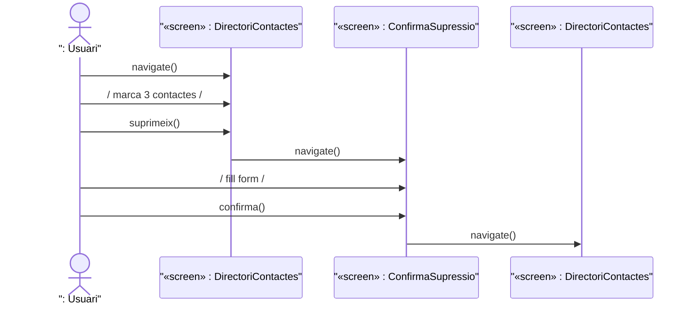
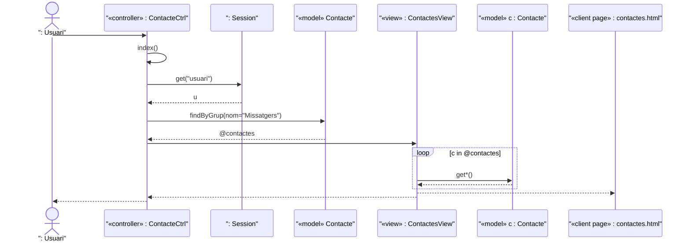
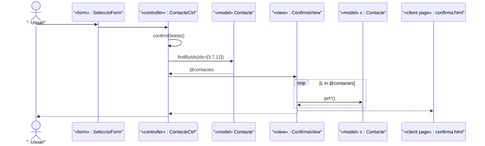
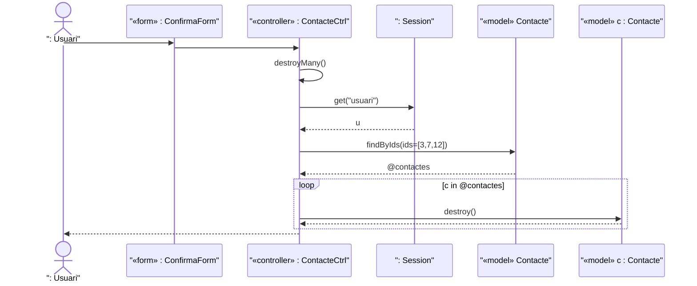

# Solució — Primer Control ASW (dimarts, 7 d'abril de 2026)

Exercici (7 punts) — **Directori de Contactes**: UX Model i Disseny Intern.

Enunciat original: [`202526q2_control_1.pdf`](202526q2_control_1.pdf)

> **Notació.** Aquesta solució segueix la notació de la solució oficial del
> professor (`teoria/Exercici 4.1 sol.pdf`): l'UX Model és un **diagrama de
> classes** amb `«screen»` i `«input form»`, i el disseny intern és
> **WAE2 + MVC**, amb **un diagrama per petició HTTP**. El resum de la notació
> el tens a [`GUIA_EXAMEN_control1.md`](GUIA_EXAMEN_control1.md).
>
> Tres coses que Mermaid no sap dibuixar i que **a mà sí que has de fer**:
> 1. Els `«input form»` són **classes associatives**, penjades de la fletxa amb
>    línia discontínua (aquí van enganxats a la screen, que és el més a prop que
>    Mermaid hi arriba).
> 2. Les **multiplicitats** de les agregacions van sobre la línia.
> 3. Les variables d'instància del `«render»` van **entre claus**:
>    `«render» {@contactes: Set(Contacte)}`. Mermaid peta amb les claus dins
>    d'una etiqueta, o sigui que als diagrames d'aquí hi surten sense.

Suposicions:

- L'usuari (p. ex. "Anna Puig") ja està loguejat: la sessió manté la seva
  identitat.
- Cada contacte té un **identificador intern enter** que no es mostra.
- Les accions no descrites (logout, gestió de grups, cerca...) queden fora de
  l'abast.

### Diagrames renderitzats

Per imprimir o estudiar sense connexió, els vuit diagrames són a
[`diagrames/`](diagrames/):

| Apartat | Fitxer |
| --- | --- |
| a) UX Model | [`1_a_UX_Model.png`](diagrames/1_a_UX_Model.png) |
| b) Storyboard | [`2_b_Storyboard.png`](diagrames/2_b_Storyboard.png) |
| c) 1/3 · GET /contactes | [`3_c1_GET_contactes.png`](diagrames/3_c1_GET_contactes.png) |
| c) 2/3 · GET /contactes/supressio | [`4_c2_GET_supressio.png`](diagrames/4_c2_GET_supressio.png) |
| c) 3/3 · DELETE (PRG) | [`5_c3_DELETE_PRG.png`](diagrames/5_c3_DELETE_PRG.png) |
| d) 1/3 · seqüència GET /contactes | [`6_d1_seq_GET_contactes.png`](diagrames/6_d1_seq_GET_contactes.png) |
| d) 2/3 · seqüència GET supressio | [`7_d2_seq_GET_supressio.png`](diagrames/7_d2_seq_GET_supressio.png) |
| d) 3/3 · seqüència DELETE (PRG) | [`8_d3_seq_DELETE_PRG.png`](diagrames/8_d3_seq_DELETE_PRG.png) |

---

## a) [2 punts] UX Model: Screens & Navigational Paths

```mermaid
classDiagram
    direction LR

    class DirectoriContactes {
        <<screen>>
        usuariLoguejat : String
        grupSeleccionat : String
        seleccionaGrup()
        creaContacte()
        editaContacte()
        suprimeix()
    }

    class EditaContacte {
        <<screen>>
        grup : String
        missatgeError : String [0..1]
        desa()
        cancella()
    }

    class ConfirmaSupressio {
        <<screen>>
        grup : String
        missatgeError : String [0..1]
        confirma()
        cancella()
    }

    class Grup {
        nom : String
    }

    class Contacte {
        nom : String
        carrec : String
        correu : String
        telefon : String
    }

    class SeleccioForm {
        <<input form>>
        selectContacte : checkbox [*]
    }

    class ContacteForm {
        <<input form>>
        nom : text
        cognoms : text
        carrec : text
        correu : text
        telefon : text
    }

    class ConfirmaForm {
        <<input form>>
        contrasenya : password
    }

    DirectoriContactes o-- Grup : *
    DirectoriContactes o-- Contacte : *
    EditaContacte o-- Contacte : 0..1
    ConfirmaSupressio o-- Contacte : *

    DirectoriContactes --> DirectoriContactes : Selecciona grup
    DirectoriContactes --> EditaContacte : Crea / Edita
    DirectoriContactes --> ConfirmaSupressio : Suprimeix
    EditaContacte --> EditaContacte : Desa [error]
    EditaContacte --> DirectoriContactes : Desa [ok] / Cancella
    ConfirmaSupressio --> ConfirmaSupressio : Confirma [error]
    ConfirmaSupressio --> DirectoriContactes : Confirma [ok] / Cancella

    SeleccioForm .. DirectoriContactes
    ContacteForm .. EditaContacte
    ConfirmaForm .. ConfirmaSupressio
```

**Els formularis són classes associatives.** A mà, cadascun penja amb línia
discontínua **de la fletxa**, no de la caixa:

| `«input form»` | Penja del camí |
| --- | --- |
| `SeleccioForm` | `DirectoriContactes → ConfirmaSupressio` (*Suprimeix*) |
| `ContacteForm` | `EditaContacte → DirectoriContactes` i el bucle d'error |
| `ConfirmaForm` | `ConfirmaSupressio → DirectoriContactes` i el bucle d'error |

**Informació i operacions de cada screen** (el que l'enunciat demana
«clarament»):

| Screen | Informació | Operacions |
| --- | --- | --- |
| `DirectoriContactes` | Usuari loguejat · tots els grups · grup seleccionat · els contactes d'aquell grup, cadascun amb una casella de selecció | `seleccionaGrup()` · `creaContacte()` · `editaContacte()` · `suprimeix()` |
| `EditaContacte` | Grup · el contacte que s'edita (buit si és nou) · missatge d'error opcional | `desa()` · `cancella()` |
| `ConfirmaSupressio` | Grup · els contactes marcats per eliminar · camp de contrasenya · missatge d'error opcional | `confirma()` · `cancella()` |

Dos detalls de l'enunciat que decideixen el diagrama:

- `EditaContacte` **conserva els valors** correctes quan hi ha error;
  `ConfirmaSupressio` es torna a mostrar **amb els camps buits**.
- `EditaContacte o-- Contacte : 0..1` — el **0..1** és perquè quan crees un
  contacte nou la screen no en té cap.

---

## b) [1 punt] Storyboard Sequence

Escenari: l'usuari va a veure els contactes del grup "Missatgers" i elimina de
cop tres contactes, encertant la contrasenya.

Fixa't en les tres regles de la notació: les screens són **instàncies**, el
canvi de pantalla és un **`navigate()` de screen a screen**, i com que es torna
al directori **hi ha una segona lifeline** del mateix tipus. **No hi ha fletxes
de retorn.**

---

## c) [2 punts] Disseny intern: diagrama de classes (WAE2 + MVC)

L'escenari té **tres peticions** (la tercera redirigeix a la primera), o sigui
**tres diagrames**.

### Rutes

| # | Petició | Controlador :: acció | Resultat |
| --- | --- | --- | --- |
| 1 | `GET /contactes?grup=Missatgers` | `ContacteCtrl::index` | Renderitza `ContactesView` |
| 2 | `GET /contactes/supressio?grup=Missatgers&ids=3,7,12` | `ContacteCtrl::confirmDelete` | Renderitza `ConfirmaView` |
| 3 | `DELETE /contactes` (cos: `ids`, `contrasenya`) | `ContacteCtrl::destroyMany` | **Redirigeix** a la ruta 1 |

Les peticions 1 i 2 són **segures**; la 3 modifica i per tant no renderitza
vista: **`«redirect»`**. La contrasenya va **al cos**, mai a la URL.

### 1/3 · `GET /contactes?grup=Missatgers`

```mermaid
classDiagram
    direction LR

    class ContacteCtrl {
        <<controller>>
        index()
        confirmDelete()
        destroyMany()
    }
    class ContactesView {
        <<view>>
    }
    class contactes_html["contactes.html"] {
        <<client page>>
    }
    class SeleccioForm {
        <<form>>
        selectContacte : checkbox [*]
    }
    class Session {
        usuari : String
    }
    class Contacte {
        <<model>>
        id
        nom : String
        carrec : String
        correu : String
        telefon : String
        grup : Grup
        findByGrup(nom : String) Set~Contacte~
        save()
        destroy()
    }

    ContacteCtrl --> ContactesView : «render» @contactes
    ContactesView --> contactes_html : «builds»
    contactes_html *-- SeleccioForm
    ContacteCtrl ..> Session : «use»
    ContactesView ..> Session : «use»
    ContacteCtrl ..> Contacte : «use»
    ContactesView ..> Contacte : «use»
```

A mà, afegeix-hi la fletxa d'entrada **`«GET» /contactes?grup=Missatgers`** cap
al controlador.

### 2/3 · `GET /contactes/supressio?grup=Missatgers&ids=3,7,12`

```mermaid
classDiagram
    direction LR

    class SeleccioForm {
        <<form>>
        selectContacte : checkbox [*]
    }
    class ContacteCtrl {
        <<controller>>
        confirmDelete()
    }
    class ConfirmaView {
        <<view>>
    }
    class confirma_html["confirma.html"] {
        <<client page>>
    }
    class ConfirmaForm {
        <<form>>
        contrasenya : password
    }
    class Session {
        usuari : String
    }
    class Contacte {
        <<model>>
        findByIds(ids) Set~Contacte~
    }

    SeleccioForm --> ContacteCtrl : «submit» /contactes/supressio
    ContacteCtrl --> ConfirmaView : «render» @contactes
    ConfirmaView --> confirma_html : «builds»
    confirma_html *-- ConfirmaForm
    ContacteCtrl ..> Session : «use»
    ContacteCtrl ..> Contacte : «use»
    ConfirmaView ..> Contacte : «use»
```

### 3/3 · `DELETE /contactes` — el patró PRG

```mermaid
classDiagram
    direction LR

    class ConfirmaForm {
        <<form>>
        contrasenya : password
    }
    class ContacteCtrl {
        <<controller>>
        destroyMany()
    }
    class Session {
        usuari : String
    }
    class Contacte {
        <<model>>
        findByIds(ids) Set~Contacte~
        destroy()
    }

    ConfirmaForm --> ContacteCtrl : «submit» /contactes
    ContacteCtrl --> ContacteCtrl : «redirect» /contactes?grup=Missatgers
    ContacteCtrl ..> Session : «use»
    ContacteCtrl ..> Contacte : «use»
```

**Cap vista i cap `«builds»`.** La petició que escriu acaba amb el bucle
`«redirect»` sobre el mateix controlador. És el que la taula de rutes marca com
a «— (PRG)».

---

## d) [2 punts] Disseny intern: diagrama de seqüència

Un per petició, igual que a c).

### 1/3 · `GET /contactes?grup=Missatgers`

### 2/3 · `GET /contactes/supressio?...`

### 3/3 · `DELETE /contactes` — PRG

### Observacions

- **POST/Redirect/GET**: la petició 3 no renderitza res; respon amb el
  `# redirect`, i el navegador repeteix la petició 1. Recarregar no torna a
  esborrar.
- **La contrasenya la valida el model**, no el controlador: és regla de negoci.
  Si fos incorrecta, el model llançaria una excepció i el controlador
  renderitzaria `ConfirmaView` amb l'error i els camps buits — camí que aquest
  escenari no recorre.
- **El model apareix dues vegades**: com a **classe** per als *finders*
  (`findByGrup`, `findByIds`) i com a **instància** per a `get*()` i `destroy()`.
- El fragment **`loop`** és el que fa la vista per pintar cada fila, i el que fa
  el controlador per esborrar cada contacte.
